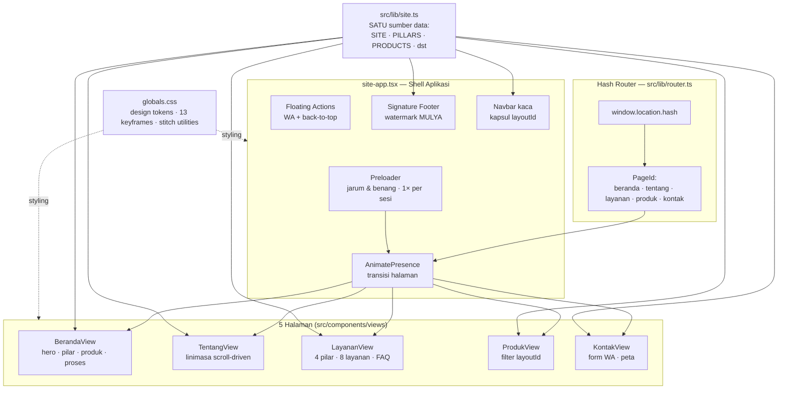
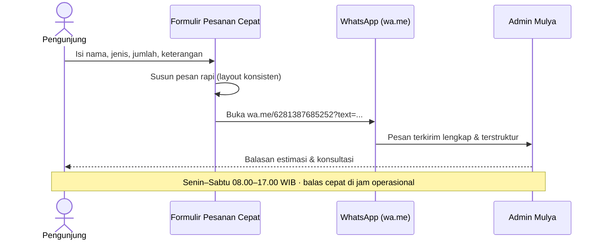

<div align="center">

```
        ╱╲
       ╱──╲      ✦  M  U  L  Y  A   K  O  N  V  E  K  S  I  ✦
      ╱ ▽ ╱▕     UJANG JUANA COLLECTION — TASIKMALAYA
     ╱──╱ ╱      Menjahit Kualitas · Merajut Kepercayaan · Est. 2020
    ╲__╲_╱
    ─┄┄┄┄┄▶     Website resmi: konveksi · pesanan khusus · grosir · retail
```

# MULYA KONVEKSI — WEBSITE

**Website multi-halaman penuh animasi untuk konveksi & produsen busana di jantung Tasikmalaya.**
Dibangun dengan standar *god mode tier max*: design system terang yang jelas dan enak dipandang,
13 keyframes CSS murni, animasi scroll-driven, watermark raksasa, dan signature footer kelas dunia.

[](https://nextjs.org/)
[](https://react.dev/)
[](https://www.typescriptlang.org/)
[](https://tailwindcss.com/)
[](https://www.framer.com/motion/)

[](https://bun.sh/)
[](https://eslint.org/)
[](#-kredit)
[](https://wa.me/6281387685252)

---

### ✦ Pratinjau Hidup — bukan mockup, inilah animasi aslinya ✦


*GIF di atas direkam langsung dari website — judul hero muncul kata demi kata, pita layanan
mengalir tanpa henti, kartu statistik melayang lembut, dan jarum terus "menjahit" ornamen.*

---

| Beranda | Tentang |
| :---: | :---: |
|  |  |
| **Layanan** | **Produk** |
|  |  |
| **Kontak** | **Tampilan Mobile** |
|  |  |

**5 halaman · 1 route · pengalaman SPA penuh** — navigasi hash `#/beranda`, `#/tentang`,
`#/layanan`, `#/produk`, `#/kontak` dengan transisi halaman sinematik.

</div>

---

## ◆ Tentang Proyek

Website resmi **Mulya Konveksi — Ujang Juana Collection**, konveksi & produsen busana yang berdiri
sejak **2020** dan kini beroperasi dari fasilitas baru di **Jl. Karikil, Kp. Cibeureum, Kel. Cipari,
Kec. Mangkubumi, Kota Tasikmalaya**. Situs ini mempresentasikan **empat pilar usaha** dalam satu
pengalaman digital yang terang, jelas, dan menyenangkan dipandang — lengkap dengan jalur pesanan
WhatsApp yang tersusun rapi otomatis.

> **Prinsip desain:** "Menjahit Kualitas, Merajut Kepercayaan". Setiap elemen visual mengambil
> bahasa dari dunia jahit — garis jahitan putus-putus emas (*stitch*), benang yang tergambar
> (*thread-path*), jarum yang berdenyut (*needle pulse*), hingga watermark raksasa di footer.

| Fakta | Detail |
| :--- | :--- |
| **Klien** | Mulya Konveksi — Ujang Juana Collection |
| **Lokasi workshop** | Jl. Karikil, Kp. Cibeureum RT 001/01, Kel. Cipari, Kec. Mangkubumi, Kota Tasikmalaya |
| **Berdiri / pindah fasilitas** | 2020 / 2025 |
| **Jam operasional** | Senin – Sabtu, 08.00 – 17.00 WIB |
| **WhatsApp resmi** | [+62 813-8768-5252](https://wa.me/6281387685252) |
| **Jumlah halaman** | 5 (Beranda, Tentang, Layanan, Produk, Kontak) |
| **Aset visual** | 13 visual AI kustom + 5 foto workshop asli + logo SVG buatan tangan |

---

## ◆ Fitur God Mode

<details open>
<summary><b>Klik untuk membuka daftar fitur lengkap</b> — atau biarkan terbuka, semuanya layak dilihat</summary>

### 1. Pengalaman & Navigasi

| Fitur | Implementasi |
| :--- | :--- |
| **Multi-halaman, satu route** | Hash router kustom (`src/lib/router.ts`) — 5 halaman penuh tanpa melanggar arsitektur single-route |
| **Transisi halaman sinematik** | `AnimatePresence` — halaman lama meluruh berskala, halaman baru naik dengan `EASE_OUT [0.22, 1, 0.36, 1]` |
| **Preloader jarum & benang** | Jarum vertikal "menjahit" ke bawah, judul muncul huruf demi huruf, progress bar emas — sekali per sesi (`sessionStorage`) |
| **Navbar kaca pintar** | Transparan di puncak → kaca putih + shadow saat scroll; kapsul indikator halaman aktif bergerak dengan `layoutId` |
| **Menu mobile fullscreen** | Latar *night green* membuka dengan clip-path melingkar, item bernomor 01–05 muncul berurutan |
| **Tombol mengambang** | WhatsApp berdenyut cincin emas + tombol kembali ke atas yang muncul otomatis |
| **Pita layanan tanpa henti** | Marquee 11 layanan berjalan dan berbalik arah, jeda saat kursor di atasnya |

### 2. Animasi (CSS murni + Framer Motion)

| Fitur | Implementasi |
| :--- | :--- |
| **Judul hero kata demi kata** | Stagger `framer-motion` — "Menjahit Kualitas, Merajut Kepercayaan." hidup per kata |
| **Linimasa scroll-driven** | Halaman Tentang: garis jahitan emas *tumbuh* mengikuti `useScroll` + `useSpring`, jarum bergerak di ujungnya |
| **Angka statistik menghitung** | Komponen `Counter` menganimasikan 2020 · 4 · 9+ · 5+ saat masuk viewport |
| **Filter produk beranimasi** | Kapsul filter `layoutId` meluncur antar pilihan, kartu tersusun ulang dengan `AnimatePresence popLayout` |
| **13 keyframes CSS** | `shimmer`, `marquee`, `marquee-reverse`, `floaty`, `spin-slow`, `pulse-ring`, `scroll-dot`, `thread-draw`, `glow-pulse`, `divider-flow`, `sig-sweep`, `sig-orbit`, `float-soft` |
| **Sorotan mikro** | `card-spotlight` (radial mengikuti kursor), `shine-btn` (kilau tombol), garis emas merambat di link footer |
| ** hormati preferensi pengguna** | Seluruh animasi dinonaktifkan otomatis bila `prefers-reduced-motion: reduce` |

### 3. Konversi & Bisnis

| Fitur | Implementasi |
| :--- | :--- |
| **Formulir pesanan ke WhatsApp** | Isi nama, jenis pesanan, jumlah, keterangan → pesan tersusun rapi terbuka di `wa.me/6281387685252` |
| **4 pilar usaha** | Produksi Konveksi · Pesanan Khusus · Grosir & Distribusi · Penjualan Retail — dengan kartu sorotan interaktif |
| **Katalog 9 produk** | 9 kategori dengan tag *Terlaris / Unggulan / Custom* dan deskripsi saat hover |
| **8 jalur layanan + 7 segmen** | Seragam sekolah hingga kebaya kustom; segmen pelanggan dari sekolah hingga reseller |
| **Peta tersemat** | Google Maps iframe lokasi workshop Kp. Cibeureum |
| **CTA di setiap halaman** | Banner "Siap Menjahit Ide Besar Anda?" dengan tombol chat & formulir |

### 4. Kualitas Teknis

| Fitur | Implementasi |
| :--- | :--- |
| **SEO lengkap** | Metadata Bahasa Indonesia + `JSON-LD ClothingStore schema` (nama, alamat, jam, geo) |
| **Aksesibilitas** | Aria-label navigasi, kontras terjaga, `alt` deskriptif, `prefers-reduced-motion`, fokus terlihat |
| **0 error lint** | `eslint .` bersih — lolos aturan `react-hooks` & `next` yang ketat |
| **Aset hemat** | Total aset visual < 4 MB; GIF pratinjau README hanya 760 KB |

</details>

---

## ◆ Empat Pilar Usaha

```
   ┌──────────────────────┐   ┌──────────────────────┐
   │  01  PRODUKSI        │   │  02  PESANAN KHUSUS  │
   │      KONVEKSI        │   │      (KUSTOM)        │
   │  Produksi massal     │   │  Per ukuran, desain, │
   │  pakaian jadi rapi   │   │  sampel disetujui    │
   └──────────┬───────────┘   └──────────┬───────────┘
              │                          │
              └──────────┐  ┌────────────┘
                         ▼  ▼
              ┌──────────────────────┐
              │   MULYA KONVEKSI     │
              │  satu standar kualit │
              └──────────┬───────────┘
                         │
              ┌──────────┴───────────┐
              │                      │
   ┌──────────▼───────────┐   ┌──────▼───────────────┐
   │  03  GROSIR &        │   │  04  PENJUALAN       │
   │      DISTRIBUSI      │   │      RETAIL          │
   │  Harga produsen,     │   │  Satuan langsung,    │
   │  suplai seluruh RI   │   │  workshop & WhatsApp │
   └──────────────────────┘   └──────────────────────┘
```

<details>
<summary><b>Lihat rincian tiap pilar</b> (data asli dari <code>src/lib/site.ts</code>)</summary>

| # | Pilar | Subjudul | Sorotan |
| :-: | :--- | :--- | :--- |
| 01 | **Produksi Konveksi** | Produksi massal pakaian jadi | Produksi massal & borongan · kontrol kualitas per batch · kapasitas menyesuaikan pesanan |
| 02 | **Pesanan Khusus** | Penjahitan kustom & kustomisasi | Ukuran & desain khusus · sampel disetujui lebih dulu · konsultasi bahan & model |
| 03 | **Grosir & Distribusi** | Penjualan partai besar | Harga langsung dari produsen · suplai rutin & stabil · siap kirim ke seluruh Indonesia |
| 04 | **Penjualan Retail** | Penjualan langsung satuan | Beli satuan langsung · katalog produk lengkap · terbuka untuk umum |

</details>

---

## ◆ Arsitektur



### Alur Pengunjung → Pesanan



---

## ◆ Design System — Terang, Jelas, Enak Dipandang

Palet di bawah adalah **asli dari kode** (`src/app/globals.css`) — bukan sekadar dekorasi README:


### Tipografi

| Peran | Font | Catatan |
| :--- | :--- | :--- |
| **Judul display** | `Playfair Display` — serif klasik | Hero, heading seksi, wordmark footer — kesan mahal khas apparel |
| **Teks & UI** | `Plus Jakarta Sans` | Dibuat untuk Bahasa Indonesia — lekukan huruf pas untuk teks panjang |
| **Aksen teknis** | `JetBrains Mono` / monospace | Chip teknologi footer, kode |

### Bahasa Visual "Menjahit"

| Elemen | Kelas | Fungsi |
| :--- | :--- | :--- |
| Garis jahitan | `.stitch-line` `.stitch-border` `.stitch-frame` | Border putus-putus emas seperti jahitan tangan di frame & kartu |
| Benang tergambar | `.thread-path` | SVG ornamen yang "digambar" oleh animasi `thread-draw` 2,6s |
| Ikon jarum | `NeedleIcon` | Jarum SVG kustom di heading seksi & preloader |
| Ornamen seksi | `.section-ornament` | Bintang emas ✦ + garis di setiap heading |
| Tekstur | `.grain` `.pattern-soft` | Tekstur halus agar latar terang tidak datar |
| Kaca | `.glass-light` `.glass-dark` | Navbar & elemen overlay |

---

## ◆ Katalog Animasi Lengkap

### CSS Keyframes (13) — murni CSS, hemat performa

| Keyframe | Kelas | Lokasi | Efek |
| :--- | :--- | :--- | :--- |
| `shimmer` | `.text-gold-gradient` | Judul emas, tagline footer | Kilau gradien emas 6s menyapu teks |
| `marquee` | `.animate-marquee` | Pita layanan | Pita berjalan tanpa henti, berhenti saat hover |
| `marquee-reverse` | `.animate-marquee-slow` | Pita ke-2 | Laju lambat, arah berlawanan |
| `floaty` | `.animate-floaty` `.-late` | Kartu hero | Kartu statistik melayang naik-turun bergantian |
| `spin-slow` | `.animate-spin-slower` | Ornamen hero | Rotasi pelan elemen dekoratif |
| `pulse-ring` | `.pulse-ring` | Tombol mengambang WA | Cincin emas berdenyut mengundang klik |
| `scroll-dot` | indikator hero | Beranda | Titik kecil mengundang scroll |
| `thread-draw` | `.thread-path` | Ornamen seksi | Benang "tergambar" 2,6s dengan easing sinematik |
| `glow-pulse` | `.animate-glow` | CTA banner | Cahaya bernafas di sekitar ajakan |
| `divider-flow` | `.footer-divider-flow` | Footer | Hairline emas mengalir 9s tanpa putus |
| `sig-sweep` | `.sig-sweep` | Panel signature | Sapuan cahaya diagonal setiap 7,5s |
| `sig-orbit` | `.sig-orbit` | Logo digiman.id | Orbit putus-putus berputar 16s |
| `float-soft` | `.animate-float-soft` | Aurora footer | Glow lembut mengapung |

### Animasi Framer Motion

| Animasi | Teknologi | Lokasi |
| :--- | :--- | :--- |
| Preloader jarum jatuh + huruf muncul | `motion` + stagger | `preloader.tsx` |
| Judul hero kata demi kata | Stagger variants | `beranda-view.tsx` |
| Transisi antar halaman | `AnimatePresence` mode wait | `site-app.tsx` |
| Linimasa tumbuh mengikuti scroll | `useScroll` + `useSpring` | `tentang-view.tsx` |
| Kapsul filter produk meluncur | `layoutId` + `popLayout` | `produk-view.tsx` |
| Angka statistik menghitung naik | `Counter` (animate 0→nilai) | `motion-primitives.tsx` |
| Reveal saat masuk viewport | `Reveal` (whileInView) | Seluruh halaman |
| Menu mobile membuka melingkar | clip-path keyframe | `navbar.tsx` |
| Kartu produk pop saat filter | `popLayout` exit scale | `produk-view.tsx` |
| Tombol mengecil saat ditekan | `whileTap scale 0.97` | Seluruh tombol |

> **Prinsip:** semua animasi menghormati `prefers-reduced-motion` — pengguna yang memilih
> gerakan minimal mendapat pengalaman statis penuh fungsi, tanpa satu pun fitur hilang.

---

## ◆ Struktur Proyek

```
mulya-konveksi/
├─ src/
│  ├─ app/
│  │  ├─ layout.tsx              # Metadata SEO · font · JSON-LD ClothingStore
│  │  ├─ globals.css             # 20 design tokens · 13 keyframes · 20+ utilities
│  │  └─ icon.svg                # Favicon monogram jarum & benang
│  ├─ components/
│  │  ├─ site-app.tsx            # Shell: preloader · transisi · scroll reset
│  │  ├─ navbar.tsx              # Kaca · kapsul aktif layoutId · menu fullscreen
│  │  ├─ footer.tsx              # Signature Footer · watermark · panel digiman.id
│  │  ├─ preloader.tsx           # Jarum & benang pembuka
│  │  ├─ logo.tsx                # LogoMark / LogoWordmark / LogoLockup (SVG)
│  │  ├─ motion-primitives.tsx   # Reveal · Counter · SectionHeading · PageHero
│  │  │                          #   NeedleIcon · WaIcon · WaButton · EASE_OUT
│  │  ├─ marquee.tsx             # Pita layanan berjalan
│  │  ├─ floating-actions.tsx    # WA pulse + back-to-top
│  │  ├─ cta-banner.tsx          # "Siap Menjahit Ide Besar Anda?"
│  │  ├─ pillar-cards.tsx        # 4 pilar usaha interaktif
│  │  ├─ workshop-gallery.tsx    # Galeri foto workshop asli
│  │  ├─ page-link.tsx           # Tautan antar halaman + scroll reset
│  │  └─ views/
│  │     ├─ beranda-view.tsx     # Hero · statistik · pilar · produk · proses
│  │     ├─ tentang-view.tsx     # Narasi · linimasa scroll · nilai · visi
│  │     ├─ layanan-view.tsx     # 4 pilar detail · 8 layanan · bahan · FAQ
│  │     ├─ produk-view.tsx      # Katalog 9 produk + 6 filter
│  │     └─ kontak-view.tsx      # Info · formulir WA · peta
│  └─ lib/
│     ├─ site.ts                 # ★ SATU sumber data seluruh situs
│     ├─ router.ts               # Hash router + PAGE_IDS + judul halaman
│     └─ utils.ts
├─ public/
│  ├─ logo.svg                   # Logo mandiri untuk dokumen & share
│  └─ images/
│     ├─ hero-workshop.png       # Visual hero AI kustom
│     ├─ prod-*.png (9)          # Katalog produk AI kustom
│     ├─ about-hands-bright.png · grosir-warehouse.png · kain-rolls.png
│     └─ workshop/*.jpg (5)      # Foto workshop ASLI (produksi, cutting, mesin…)
├─ docs/preview/                 # Aset README: GIF animasi, screenshot, palet
├─ scripts/generate-images.mjs   # Generator visual AI (z-ai-web-dev-sdk)
└─ README.md
```

---

## ◆ Sumber Data Tunggal — `src/lib/site.ts`

Seluruh konten situs — dari nomor WhatsApp hingga 9 produk — hidup di **satu berkas**.
Mengubah satu konstanta memperbarui seluruh 5 halaman secara konsisten:

```ts
// Nomor WhatsApp resmi (format internasional tanpa "+")
export const WHATSAPP_NUMBER = "6281387685252";

// Tampilan nomor dengan pemisah mudah dibaca
export const PHONE_DISPLAY = "+62 813-8768-5252";

export const waLink = (customMessage?: string) =>
  `https://wa.me/${WHATSAPP_NUMBER}${
    customMessage ? `?text=${encodeURIComponent(customMessage)}` : ""
  }`;
```

| Ekspor | Isi | Dipakai di |
| :--- | :--- | :--- |
| `SITE` | Nama, tagline, alamat, jam, URL Maps | Semua halaman, footer, JSON-LD |
| `PILLARS` (4) | Empat pilar usaha + poin | Beranda, Layanan, Footer |
| `SERVICES` (8) | Jalur layanan produksi | Layanan |
| `PRODUCTS` (9) + `PRODUCT_FILTERS` | Katalog + 6 kategori filter | Produk, Beranda |
| `PROCESS_STEPS` (5) | Konsultasi → garansi | Beranda, Layanan |
| `TIMELINE` (4) | 2020 → 2025 → hari ini | Tentang |
| `SEGMENTS` (7) · `MATERIALS` (12) · `FAQ` (4) · `STATS` · `MARQUEE_ITEMS` · `VALUES` | Segmen, bahan, tanya-jawab | Beranda, Layanan, Tentang |
| `WHATSAPP_NUMBER` · `PHONE_DISPLAY` · `INSTAGRAM_HANDLE` | Kanal kontak | Formulir, footer, kontak |

---

## ◆ Memulai

```bash
# 1. Instal dependensi (Bun — cepat dan tegas)
bun install

# 2. Jalankan server pengembangan di http://localhost:3000
bun run dev

# 3. Periksa kualitas kode
bun run lint

# 4. Build produksi + jalankan
bun run build
bun run start
```

| Skrip | Perintah | Fungsi |
| :--- | :--- | :--- |
| `dev` | `bun run dev` | Server pengembangan Turbopack, port 3000, log ke `dev.log` |
| `build` | `bun run build` | Build produksi + salin static & public ke standalone |
| `start` | `bun run start` | Jalankan hasil build produksi |
| `lint` | `bun run lint` | ESLint 9 — konfigurasi `next` ketat |

**Prasyarat:** [Bun](https://bun.sh) ≥ 1.3 (atau Node.js ≥ 20 dengan `npm run dev`).

---

## ◆ Kustomisasi Cepat

Semua penyesuaian bisnis dilakukan **tanpa menyentuh komponen**:

```ts
// src/lib/site.ts — contoh perubahan umum
export const WHATSAPP_NUMBER = "6281387685252"; // ganti nomor WA di sini
export const PHONE_DISPLAY   = "+62 813-8768-5252";

// Tambah produk baru? Cukup tambahkan objek:
{
  name: "Blazer Kerja",
  category: "Outerwear",           // category + image + desc + tag (opsional)
  image: "/images/prod-blazer.png",
  desc: "Potongan tegas untuk penampilan profesional.",
  tag: "Baru",
}
```

| Ingin mengubah… | Edit di… |
| :--- | :--- |
| Nomor WhatsApp / tampilan nomor | `site.ts` → `WHATSAPP_NUMBER`, `PHONE_DISPLAY` |
| Alamat / jam operasional / peta | `site.ts` → `SITE` (alamat, `mapsUrl`, `mapsEmbed`) |
| Produk, layanan, FAQ, bahan | `site.ts` → array terkait |
| Warna tema | `globals.css` → `--color-*` tokens (satu titik, seluruh situs ikut) |
| Logo | `components/logo.tsx` + `app/icon.svg` + `public/logo.svg` |
| Visual/gambar | `scripts/generate-images.mjs` → jalankan ulang |

---

## ◆ Kualitas & Standar

- **Aksesibilitas** — landmark HTML semantik (`nav`, `main`, `footer`, `address`), aria-label
  pada setiap kontrol ikon, fokus keyboard terlihat, kontras teks aman di tema terang & gelap.
- **Performa animasi** — animasi CSS `transform`/`opacity` murni (compositor-friendly),
  `will-change` terukur, tidak ada animasi yang memicu layout thrashing.
- **SEO** — metadata lengkap Bahasa Indonesia, Open Graph, `JSON-LD` schema `ClothingStore`
  (nama, alamat, koordinat, jam buka, kategori), sitemap-friendly karena konten dirender SSR.
- **Konsistensi** — lint 0 error; aturan ketat `react-hooks` (setState hanya dalam callback
  aman-hydration) dipatuhi di seluruh komponen.

---

## ◆ Privasi & Kerahasiaan Data

Situs ini **sengaja** hanya menampilkan informasi publik untuk pelanggan:

- Struktur bisnis yang ditampilkan: **empat pilar usaha** — hal yang justru menjadi keunggulan pemasaran.
- Dokumen legal, izin usaha, kode klasifikasi, modal, dan data internal lain **tidak dimuat,
  tidak direferensikan, dan tidak tersirat** di mana pun pada kode maupun konten situs.
- Formulir kontak **tidak menyimpan data di server** — pengunjung diarahkan ke WhatsApp dengan
  data yang mereka isi sendiri.

---

## ◆ Roadmap

- [ ] Katalog produk dinamis (CMS / API) dengan pencarian
- [ ] PWA — dapat dipasang, siap offline
- [ ] Galeri portofolio proyek nyata per kategori
- [ ] Umpan Instagram tersemat
- [ ] Estimasi biaya produksi mandiri (kalkulator pesanan)
- [ ] Versi bahasa Inggris untuk pelanggan luar negeri

---

## ◆ Kredit

<div align="center">

```
   ╔══════════════════════════════════════════════════════════════════╗
   ║                                                                  ║
   ║        SUPPORT SYSTEM BY  PT DIGITAL BISNIS MANAJEMEN            ║
   ║                          digiman.id                              ║
   ║                                                                  ║
   ║              DESIGN BY  muhdin.web.id                            ║
   ║      signature footer diadaptasi dari desain muhdin              ║
   ║                                                                  ║
   ╚══════════════════════════════════════════════════════════════════╝
```

**Support system by [PT Digital Bisnis Manajemen — digiman.id](https://digiman.id)**
Infrastruktur sistem, pengelolaan konten, dan dukungan teknis situs ini.

**Design by — [muhdin.web.id](https://muhdin.web.id/)**
Signature footer diadaptasi dari desain *world-class* milik muhdin ke tema Mulya Konveksi.

---

<sub>Mulai hari ini — Senin–Sabtu 08.00–17.00 WIB · WhatsApp [+62 813-8768-5252](https://wa.me/6281387685252)</sub>

<sub>© 2026 Mulya Konveksi — Ujang Juana Collection. Seluruh hak cipta dilindungi.</sub>

<sub>Dijahit dengan bangga di Tasikmalaya · Jawa Barat</sub>

</div>

