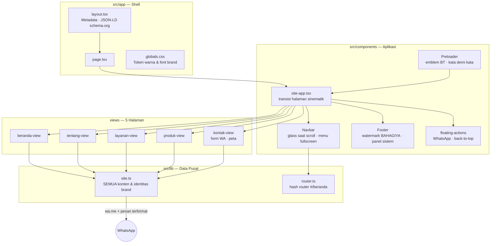

<div align="center">

```
╔══════════════════════════════════════════════════╗
║  ✦  B  A  H  A  G  I  Y  A   T  A  Y  L  O  R  ✦  ║
║         G R O U P S   ·   ( B T )                 ║
╚══════════════════════════════════════════════════╝
   ─┄┄┄┄┄▶  Konveksi · Pesanan Khusus · Grosir · Retail
```

# BAHAGIYA TAYLOR GROUPS — WEBSITE

**Menjahit Kualitas · Merajut Kepercayaan · Est. 2026**

Website resmi **Bahagiya Taylor Groups — Konveksi & Produsen Busana**,
badan hukum Perseroan Perorangan yang disahkan Kementerian Hukum RI,
berkedudukan di Kabupaten Tasikmalaya, Jawa Barat.

[](https://nextjs.org)
[](https://react.dev)
[](https://typescriptlang.org)
[](https://tailwindcss.com)
[](https://www.framer.com/motion/)
[](https://bun.sh/)

**Satu halaman, lima dunia.** Beranda · Tentang · Layanan · Produk · Kontak —
`#/beranda`, `#/tentang`, `#/layanan`, `#/produk`, `#/kontak` dengan transisi halaman sinematik.

</div>

---

## ◆ Tentang Perusahaan

| Data | Nilai |
| --- | --- |
| **Nama resmi** | BAHAGIYA TAYLOR GROUPS (Perseroan Perorangan) |
| **Bentuk badan** | Badan Hukum Perseroan Perorangan — Usaha Mikro |
| **Pengesahan** | Keputusan Menteri Hukum RI No. **AHU-A138368.AH.01.30.Tahun 2026**, ditetapkan **9 November 2026** |
| **Pendiri** | Abdul Mukdas |
| **Kantor & workshop** | Kp. Cisodong RT 008 / RW 004, Cikalong, Kec. Cikalong, **Kabupaten Tasikmalaya, Jawa Barat 46195** |
| **Bidang utama** | Industri Pakaian Jadi (Konfeksi) dari Tekstil — KBLI 14111, plus 17 bidang usaha tekstil lainnya |
| **Pilar usaha** | Produksi Konveksi · Pesanan Khusus · Grosir & Distribusi · Penjualan Retail |
| **Jam operasional** | Senin – Sabtu, 08.00 – 17.00 WIB |

Perusahaan ini berdiri di Tasikmalaya dengan keyakinan sederhana: busana berkualitas
tidak harus datang dari kota besar. Legalitas yang lengkap (badan hukum + NPWP badan)
menjadikan Bahagiya Taylor Groups siap melayani pesanan sekolah, instansi, dan korporat
dengan surat-menyurat resmi.

## ◆ Tentang Situs Ini

Situs ini adalah **aplikasi single-page berbasis hash router** — lima halaman tampil dari
satu route `/` tanpa reload, dengan transisi beranimasi Framer Motion. Seluruh konten
(dari nomor WhatsApp hingga 9 produk) hidup di **satu berkas** konfigurasi:
[`src/lib/site.ts`](src/lib/site.ts).

| Fitur | Detail |
| --- | --- |
| **Preloader sinematik** | Emblem BT emas, nama brand muncul kata demi kata, progress bar emerald→gold |
| **Hero beranimasi** | Judul muncul kata demi kata, kartu statistik melayang, pita layanan berjalan (marquee) |
| **4 Pilar Usaha** | Kartu ikon + poin unggulan tiap pilar |
| **8 Jalur Layanan** | Seragam, kaos/polo, jersey, jaket, gamis, seragam kerja, bordir & sablon, kustom/kebaya |
| **Katalog produk** | 9 kategori dengan filter animasi (Kaos & Atasan / Seragam / Olahraga / Busana Muslim / Outerwear / Kustom) |
| **Galeri workshop** | Foto produksi asli dengan caption & layout bento |
| **Formulir pesanan ke WhatsApp** | Isi nama, jenis pesanan, jumlah, keterangan → pesan tersusun rapi terbuka di `wa.me` |
| **Peta tersemat** | Google Maps iframe lokasi workshop Cikalong |
| **Signature footer** | Watermark raksasa "BAHAGIYA" outline emas, panel sistem & desain, bar kepercayaan |
| **Tombol mengambang** | WhatsApp + tombol kembali ke atas yang muncul otomatis |
| **Aksesibilitas & motion** | Guard `prefers-reduced-motion`, ARIA label lengkap, fokus keyboard terlihat |

## ◆ Teknologi

| Lapisan | Teknologi |
| --- | --- |
| Framework | **Next.js 16** (App Router) + **React 19** |
| Bahasa | **TypeScript 5** |
| Styling | **Tailwind CSS 4** + token warna & font custom di `globals.css` |
| Animasi | **Framer Motion 12** (page transitions, reveal, floating) |
| Komponen | shadcn/ui (Radix UI) |
| Font | **Playfair Display** (judul, serif elegan) + **Plus Jakarta Sans** (body) |
| Ikon | lucide-react |
| Runtime | Bun (disarankan) / Node.js |

## ◆ Arsitektur



**Prinsip tunggal:** satu-satunya tempat mengubah identitas perusahaan adalah
`src/lib/site.ts` — seluruh halaman membaca dari sana.

## ◆ Struktur Proyek

```
bahagiya-taylor-groups/
├── src/
│   ├── app/
│   │   ├── layout.tsx            # Metadata SEO + JSON-LD ClothingStore
│   │   ├── page.tsx              # Entry → SiteApp
│   │   ├── globals.css           # Token brand: cream, emerald, gold, night
│   │   ├── icon.svg              # Favicon — emblem BT di kotak zamrud
│   │   └── api/route.ts
│   ├── components/
│   │   ├── logo.tsx              # LogoMark (emblem BT) + LogoWordmark + Lockup
│   │   ├── navbar.tsx            # Header glass + menu mobile fullscreen
│   │   ├── footer.tsx            # Signature footer + watermark BAHAGIYA
│   │   ├── preloader.tsx         # Intro sinematik
│   │   ├── floating-actions.tsx  # Tombol WhatsApp & back-to-top
│   │   ├── marquee.tsx · pillar-cards.tsx · cta-banner.tsx
│   │   ├── workshop-gallery.tsx  # Galeri foto produksi
│   │   ├── motion-primitives.tsx # Reveal, PageHero, WaButton, WaIcon
│   │   ├── ui/                   # Komponen shadcn/ui
│   │   └── views/                # 5 halaman: beranda/tentang/layanan/produk/kontak
│   ├── lib/
│   │   ├── site.ts               # ★ DATA PUSAT — identitas & konten
│   │   └── router.ts             # Hash router + judul halaman
│   └── hooks/
├── public/
│   ├── logo.svg                  # Logo utama (ring zamrud + monogram BT emas)
│   └── images/                   # Foto produk & workshop
├── package.json · bun.lock · tsconfig.json · tailwind.config.ts
└── Caddyfile                     # Reverse proxy (deployment)
```

## ◆ Konfigurasi Cepat

Seluruh identitas situs diatur di **`src/lib/site.ts`**:

```ts
// ⚠️ WAJIB DIGANTI — dokumen legal perusahaan TIDAK memuat nomor telepon.
// Isi nomor WhatsApp resmi Bahagiya Taylor Groups (angka saja, tanpa "+").
export const WHATSAPP_NUMBER = "6281200000000";     // ← ganti di sini
export const PHONE_DISPLAY   = "+62 812-0000-0000"; // ← sinkronkan tampilannya

export const SITE = {
  name: "Bahagiya Taylor Groups",
  brandLine: "Konveksi & Produsen Busana",
  estYear: 2026,
  addressOneLine:
    "Kp. Cisodong RT 008 / RW 004, Cikalong, Kec. Cikalong, Kabupaten Tasikmalaya, Jawa Barat 46195",
  // ... alamat, peta, jam operasional
};
```

| Yang ingin diubah | Lokasi |
| --- | --- |
| Nomor WhatsApp / tampilan nomor | `site.ts` → `WHATSAPP_NUMBER`, `PHONE_DISPLAY` |
| Nama, tagline, alamat, peta | `site.ts` → `SITE` |
| Pesan WhatsApp default | `site.ts` → `DEFAULT_WA_MESSAGE` |
| Produk, layanan, pilar, FAQ, linimasa | `site.ts` → `PRODUCTS`, `SERVICES`, `PILLARS`, `FAQ`, `TIMELINE` |
| Logo & emblem | `src/components/logo.tsx`, `public/logo.svg`, `src/app/icon.svg` |
| Warna & font brand | `src/app/globals.css` + `src/app/layout.tsx` |

## ◆ Menjalankan Proyek

```bash
# 1. Instal dependensi (disarankan: bun)
bun install
#    atau: npm install / pnpm install

# 2. Siapkan skema database lokal (jika diperlukan)
bun run db:push

# 3. Mode pengembangan → http://localhost:3000
bun run dev

# 4. Build produksi (standalone) + jalankan
bun run build
bun run start

# 5. Lint
bun run lint
```

## ◆ Identitas Visual

- **Emblem** — monogram **"BT"** dijahit dari benang emas: lingkaran zamrud, tusuk
  jahitan keliling, jarum dan kilau bintang. Vektor murni (`logo.tsx`, `logo.svg`,
  `icon.svg`) sehingga tajam di semua ukuran.
- **Palet warna** — cream `#faf6ec` · emerald `#0e5b43` · gold `#c9962b` · night `#0b1511`
  (token lengkap di `globals.css`).
- **Tipografi** — Playfair Display untuk judul (elegan, klasik) dan Plus Jakarta Sans
  untuk teks (modern, bersih).

## ◆ Catatan Legal & Privasi

- Data perizinan, NPWP badan, rincian KBLI, dan data keuangan sifatnya **RAHASIA** dan
  sengaja **tidak dimuat** di situs publik — berlaku juga untuk dokumen pajak apa pun
  (nomor akun/password Wajib Pajak **tidak boleh** pernah dipublikasikan di repo atau situs).
- Formulir kontak **tidak menyimpan data di server** — pengunjung diarahkan ke WhatsApp
  dengan pesan yang tersusun otomatis.
- Peta Google Maps hanya menerima alamat workshop publik.

## ◆ Kredit

Signature footer diadaptasi dari desain *world-class* milik [muhdin.web.id](https://muhdin.web.id/)
(by [digiman.id](https://digiman.id)) ke tema Bahagiya Taylor Groups — support system oleh
PT Digital Bisnis Manajemen.

---

<div align="center">

**BAHAGIYA TAYLOR GROUPS** — Konveksi & Produsen Busana
Kp. Cisodong RT 008/RW 004, Cikalong, Kab. Tasikmalaya, Jawa Barat
Berbadan hukum Perseroan Perorangan · SK Kemenkumham RI, 9 November 2026

<sub>© 2026 Bahagiya Taylor Groups. Seluruh hak cipta dilindungi.</sub>
<sub>Mulai hari ini — Senin–Sabtu 08.00–17.00 WIB · hubungi kami melalui WhatsApp (nomor diatur di `site.ts`)</sub>

</div>
